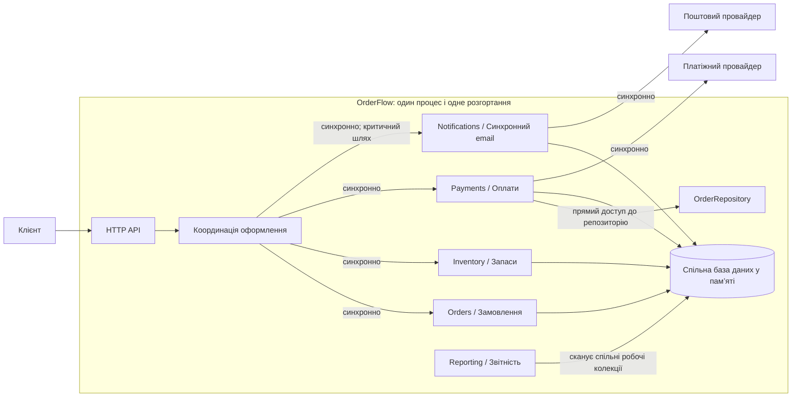
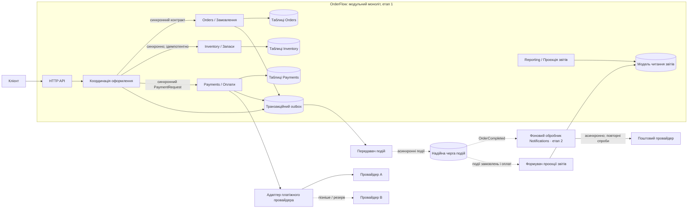

# OrderFlow — архітектура під час змін

**Модуль 1 · Аналіз архітектурних рішень**  
**Рекомендація:** поступово розвивати модульний моноліт. Не перетворювати всі п’ять модулів на окремі сервіси одночасно.

## Головне архітектурне рішення

На першому етапі залишити `Orders`, `Payments`, `Inventory`, `Notifications` і `Reporting` у межах модульного моноліту, але зробити явними контракти та відповідальність за дані. Насамперед прибрати прямий доступ `Payments` до `OrderRepository`, відокремити звітність від робочих колекцій і прибрати доставку email із критичного синхронного сценарію оформлення замовлення.

`Notifications` — перший кандидат на незалежне розгортання, але лише після появи постійного сховища, транзакційний журнал подій (outbox), надійної доставки подій, ідемпотентності, повторних спроб, черга невдалих повідомлень (DLQ) та достатнього моніторингу.

Не погоджуюся з пропозицією одразу розділити всі модулі на мікросервіси. У команді 8 інженерів і 2 QA, немає окремої команди платформи, а `Inventory` потребує сильної узгодженості. Передчасний поділ замінить внутрішні залежності мережевими збоями, розподіленими проблемами узгодженості та додатковою операційною роботою.

## 1. Поточна архітектура

### Факти з репозиторію та наданих метрик

- `src/checkout/CheckoutService.js`: сценарій оформлення синхронно чекає на `sendOrderConfirmation()` після списання коштів і встановлення статусу `COMPLETED`. Спільний `catch` у разі помилки email звільняє резерв товару та позначає замовлення як `FAILED`; повернення коштів при цьому не виконується. Отже, збій сповіщення може створити розбіжність між оплатою, статусом замовлення та резервом.
- `src/payments/PaymentService.js`: модуль оплат отримує `OrderRepository` і читає замовлення напряму замість використання явного контракту платіжного запиту. Це порушення межі між модулями.
- `src/reporting/ReportingService.js`: звітність напряму читає замовлення, платежі, сповіщення й товари зі спільної бази; частина обчислень повторно сканує колекції. Через це звітність залежить від внутрішньої структури чужих модулів.
- `src/orders/OrderService.js` використовує спільну базу для цін товарів, а `src/inventory/InventoryService.js` змінює складські залишки. Власник даних не визначений достатньо чітко.
- `src/payments/FakePaymentProvider.js` і `src/notifications/FakeNotificationProvider.js` передаються через впровадження залежностей у конструкторі. Це корисну точку розширення потрібно зберегти й формалізувати, а не переписувати без потреби.
- `src/inventory/InventoryService.js` використовує ключі ідемпотентності для резервування та звільнення товару. Цю поведінку потрібно зберегти.
- Початкові автоматизовані тести: **5 із 5 пройшли** (`npm test`); демонстраційний сценарій успішно завершує оформлення замовлення. Наявні тести не перевіряють збій сповіщення після списання коштів і не встановлюють правила залежностей між модулями.

Надані метрики показують погіршення процесу розробки й доставки змін: частота релізів знизилася з 5 до 2 на тиждень; час проходження зміни (Change Lead Time) зріс із 2 до 6 днів; середній розмір PR — зі 180 до 520 рядків; кількість модулів, яких торкається одна функція (Modules Changed per Feature), зросла з 1,7 до 4,3; частка відкатів — із 2% до 9%; тривалість розгортання — з 8 до 27 хвилин; інциденти — з 1 до 5 на місяць; середній час відновлення (MTTR) — із 35 до 95 хвилин. Це свідчить про погіршення доставки й експлуатації, але саме по собі не доводить, що кожне погіршення спричинене архітектурою.

## 2. Пріоритетні архітектурні характеристики

| Пріоритет | Характеристика | Обґрунтування та ціль |
|---|---|---|
| 1 | **Надійність і коректність оформлення замовлення** | Оплата та резерв товару мають залишатися узгодженими. Збій email не повинен переводити оплачене замовлення у `FAILED`. Прийнятний компроміс — лист може надійти пізніше. |
| 2 | **Модифікованість і супроводжуваність** | Кількість модулів на одну зміну зросла до 4,3, а час проходження зміни — до 6 днів. Потрібні явні контракти, власники даних і менші набори змін; не треба вимагати незалежного розгортання кожного модуля за будь-яку ціну. |
| 3 | **Доступність і стійкість до збоїв** | Платіжний провайдер іноді відповідає 1,5–3 секунди; описані інциденти через стрибки затримки. Потрібні обмеження часу очікування, ідемпотентність і нормалізація помилок провайдера. Повторні спроби та резервний провайдер додають складності. |
| 4 | **Масштабованість звітності** | Трафік звітності може зрости у 8–10 разів, а більшість звітів допускає затримку в кілька хвилин. Потрібна окрема модель читання для звітів замість сканування всіх робочих колекцій. Компроміс — дані у звітах оновлюватимуться із затримкою. |
| 5 | **Вибіркова незалежність розгортання** | Спільний графік релізів затримує невеликі зміни. Незалежно розгортати слід лише ті компоненти, де це знижує підтверджену вартість змін. |

## 3. Підсумок рішення

### Проблема

Зміни дедалі частіше охоплюють кілька модулів і проходять спільний цикл тестування та розгортання. Спільні структури даних приховують залежності. Синхронне надсилання email перебуває на критичному шляху оформлення замовлення.

### Факти та докази

- 48% PR із новими функціями одночасно змінюють `Orders` і `Payments`.
- 37% змін шаблонів сповіщень потребують повного регресійного тестування оформлення замовлення.
- Частота релізів зменшилася з 5 до 2 на тиждень; час проходження зміни зріс із 2 до 6 днів; частка відкатів зросла з 2% до 9%.
- У коді `Payments` читає `OrderRepository`, `Reporting` читає спільні робочі колекції, а процес оформлення чекає на email після завершення оплати.

### Рішення

1. **Зараз:** залишити модульний моноліт; задокументувати контракти та власність даних; прибрати прямий доступ `Payments` до репозиторію `Orders`; зберегти ідемпотентність `Inventory`.
2. **Перед асинхронною обробкою:** зробити дані замовлень, платежів і складських операцій постійними, а не лише в пам’яті; додати транзакційний журнал подій (outbox). Це передумова для надійної доставки подій.
3. **Спочатку `Notifications`:** після впровадження outbox і черги створити фоновий обробник, що споживає подію `OrderCompleted`. Помилка email більше не визначатиме результат оформлення замовлення. Цей обробник стане першим кандидатом на незалежне розгортання.
4. **`Reporting`:** наповнювати власну модель читання подіями й дозволити затримку даних до кількох хвилин. Відокремлювати розгортання або сховище лише тоді, коли метрики підтвердять таку потребу.
5. **`Payments`:** поки залишити модулем моноліту, але зробити явний контракт `PaymentRequest` із сумою та валютою й адаптер платіжного провайдера. Розглянути окремий сервіс після появи другого провайдера або підтвердженої потреби в окремих SLO та масштабуванні.

### Компроміси

- **Відхиляємо негайний поділ усіх модулів на мікросервіси:** не додаємо передчасно мережеві збої, розподілені транзакції, дублювання даних та операційне навантаження для команди без команди платформи.
- **Приймаємо асинхронні сповіщення:** оформлення замовлення стає стійкішим, але email може надійти пізніше. Потрібні повторні спроби, ідемпотентність, черга невдалих повідомлень (DLQ), моніторинг і звірка станів.
- **Приймаємо окрему модель читання звітів:** менше навантаження на робочі дані, але звіти можуть оновлюватися із невеликою затримкою.
- **Зберігаємо сильну узгодженість для `Inventory`:** не відокремлювати резервування та списання товару до визначення надійних гарантій транзакцій і ідемпотентності.
- **Додаємо постійну базу та outbox:** зростає вартість інфраструктури порівняно з демонстраційною базою в пам’яті, але це потрібно для відновлення після перезапуску й надійної доставки критичних подій.

### Як вимірюватимемо успіх

Протягом 2–3 циклів доставки порівнювати кількість модулів на зміну, час проходження зміни, частку відкатів, p95 оформлення замовлення, затримку від події сповіщення до його доставки та свіжість звітів. Якщо показники не покращуються або операційні витрати нівелюють виграш, потрібно переглянути межі й не продовжувати відокремлення автоматично.

## 4. Запропонована архітектура

### Правила меж та взаємодій

- **Синхронно:** `Checkout` → `Orders/Pricing`, резерв `Inventory`, запит на оплату до `Payments`. Ці операції визначають, чи можна завершити оформлення замовлення.
- **Асинхронно:** `OrderCompleted` → `Notifications`. Збій email не скасовує вже списані кошти й не звільняє резерв; фоновий обробник підтримує повторні спроби та ідемпотентність.
- **Асинхронно:** події замовлень і платежів → модель читання звітів. Цільова свіжість даних — p95 менше 5 хвилин у звичайних умовах для звітів, де така затримка прийнятна.
- **Власність даних:** на початку можна зберегти одну постійну реляційну базу, але таблиці та репозиторії мають належати окремим модулям. Окремі сервери баз даних не обов’язкові на першому етапі.
- **Межа зовнішнього провайдера:** зберегти підставляння провайдера через інтерфейс, нормалізувати результати, встановити тайм-аути, використовувати ключі ідемпотентності та вимірювати затримки й помилки. Другого провайдера додавати після визначення його контракту.
- Публікація подій через outbox має бути надійною, а споживачі — ідемпотентними. Звичайний внутрішній механізм подій процесу не підходить для критичних подій: процес може завершитися до їх обробки.

## 5. Архітектурні принципи

| Принцип | Поточний стан | Як застосовується в рішенні |
|---|---|---|
| **Приховування інформації та явні контракти** | `Payments` імпортує репозиторій `Orders`; кілька модулів читають спільну базу напряму. | `Payments` отримує DTO `PaymentRequest`, а не читає чужий репозиторій. Кожен модуль відкриває лише власні операції та контракти. |
| **Висока зв’язність усередині модуля (High Cohesion)** | `Reporting` формує звіти, скануючи замовлення, платежі, сповіщення й товари під час запиту. | `Reporting` має власну модель читання; зміни шаблонів залишаються всередині `Notifications`. |
| **Напрям залежностей** | Спільні структури бази стають неявним публічним API; `Payments` залежить від деталей зберігання `Orders`. | Модулі залежать від контрактів і портів, а не від внутрішніх репозиторіїв інших модулів. Провайдери приховані за адаптерами. |
| **Проєктування з урахуванням змін** | Експерименти зі сповіщеннями запускають широку регресійну перевірку та спільне розгортання застосунку. | Подія `OrderCompleted` відокремлює графік і шаблони сповіщень від життєвого циклу оформлення замовлення. |
| **Архітектурні перевірки (fitness functions)** | Тести не перевіряють правила залежностей і збій сповіщення після списання коштів. | Додати автоматичні перевірки залежностей і сценаріїв збоїв, щоб архітектурні припущення можна було постійно перевіряти. |

## 6. Аналіз вартості змін

**Сценарій:** додавання нового шаблону сповіщення або експерименту із сегментацією. Це трапляється часто — 2–3 експерименти на тиждень; 37% змін шаблонів зараз вимагають повного регресійного тестування оформлення замовлення.

Нижче наведені планові припущення, а не фактичні табелі робочого часу. Для порівняння прийнято умовну ставку **$50 за годину інженерної роботи**.

| Робота | Поточний спільний моноліт | Запропонований фоновий обробник сповіщень |
|---|---:|---:|
| Змінені модулі/компоненти | 1–2; іноді `Checkout`/`Orders` для сегментаційних даних | 1 компонент шаблону/обробника за стабільного контракту події |
| Реалізація | 8 год | 6 год |
| Координація | 3 год | 1 год |
| Тестування | 8 год — широка регресія оформлення замовлення | 3 год — шаблон, контракт, повторні спроби й ідемпотентність; періодичні E2E-тести залишаються |
| Роботи з випуску | 4 год — увесь застосунок і спільне вікно релізу | 1 год — лише фоновий обробник після його відокремлення |
| **Разом** | **23 год** | **11 год** |
| **Оціночна вартість зміни** | **$1 150** | **$550** |

Очікувана економія на подібній зміні — **12 інженерних годин / $600 (приблизно 52%)**. Одноразове відокремлення оцінюється у 80–120 годин ($4 000–$6 000) без урахування подальшої інфраструктури та експлуатації. Заощадженням часу воно окупиться приблизно після 7–10 подібних змін, якщо економія 12 годин справдиться. Перевірити результат потрібно через 4–6 тижнів, а не вважати окупність гарантованою.

## 7. Аналіз ризиків

Ймовірність і фінансовий вплив нижче — явні планові припущення, а не виміряні збитки. Для ризиків R1–R3 імовірність означає шанс хоча б одного суттєвого інциденту протягом наступних 12 місяців; для R4 — шанс інциденту під час міграції. Формула: **Очікувана вартість ризику = Ймовірність × Бізнес-вплив**.

| Ризик | Ймовірність | Вплив | Очікувана вартість ризику | Зменшення ризику |
|---|---:|---:|---:|---|
| **R1. Збій email після списання коштів призводить до неузгодженого стану замовлення й запасів** | 0,35 на рік | $8 000 | **$2 800 на рік** | Асинхронні сповіщення, outbox, тест переходів станів, звірка даних. |
| **R2. Затримка або недоступність платіжного провайдера впливає на оформлення замовлення** | 0,60 на рік | $25 000 | **$15 000 на рік** | Тайм-аути, адаптер, ідемпотентність, сповіщення про помилки; резервний провайдер — лише після перевірки контракту. |
| **R3. Звітні запити конкурують з оформленням замовлення при зростанні трафіку у 8–10 разів** | 0,40 на рік | $15 000 | **$6 000 на рік** | Власна проєкція звітів, бюджет запитів, навантажувальні тести та SLO свіжості даних. |
| **R4. Під час асинхронної міграції події губляться або дублюються** | 0,25 на міграцію | $12 000 | **$3 000 на міграцію** | Надійний outbox, ідемпотентні споживачі, повтори, DLQ, повторне відтворення та поетапна перевірка. |

R4 — ризик, який створює сама запропонована архітектура. Його можна прийняти лише за наявності перелічених заходів контролю. Фінансові оцінки потрібно уточнити за фактичним обсягом оформлень, маржинальним доходом, витратами підтримки та історією інцидентів.

## 8. Метрики та архітектурні перевірки

| Метрика / перевірка | Базове значення | Ціль | Для чого потрібна та коли перевіряти |
|---|---:|---|---|
| Кількість модулів на одну функцію (Modules Changed per Feature) | 4,3 | **менше 2,5** | Основний сигнал, що межі зменшують кількість залежних змін; переглянути через два квартали. |
| Час проходження зміни (Change Lead Time) | 6 днів | **не більше 3 днів** | Включає перевірки та координацію; переглядати щомісяця. |
| Частка відкатів (Rollback Rate) | 9% | **менше 5%** без зростання інцидентів | Перевіряє, що швидші випуски не знижують надійність; переглядати щомісяця. |
| p95 оформлення / очікування провайдера | Базу ще треба виміряти | Зменшувати p95 і обмежити очікування тайм-аутом | Порівнювати за однакового навантаження, окремо рахувати затримки й помилки провайдера. |
| Час від події сповіщення до доставки | Базу ще треба виміряти | p95 **менше 2 хвилин**; збій сповіщення не змінює статус оплаченої покупки | Перевіряє доставку з допустимою затримкою та ізоляцію checkout від email. |
| Затримка оновлення проєкції звітів | Базу ще треба виміряти | p95 **менше 5 хвилин** | Перевіряє, чи прийнятна узгодженість із затримкою для бізнес-звітів. |

### Легкі автоматизовані архітектурні перевірки

1. **Тест сценарію збою:** успішно списати кошти, а потім змусити поштового провайдера повернути помилку. Після виправлення замовлення має залишатися в оплаченому/завершеному стані, запас — зарезервованим, платіж — списаним, а подія сповіщення — доступною для повторної обробки. Поточний `catch` має виявити цей дефект.
2. **Правило залежностей:** `src/payments` не імпортує `OrderRepository` і не читає `database.orders`; `Reporting` не читає внутрішні колекції `Orders`, `Payments` і `Notifications`. Перевіряти автоматичним тестом або правилом CI.
3. **Правило контракту події:** зміна шаблону сповіщення не потребує змін у `Orders` чи `Checkout`, якщо схема події `OrderCompleted` не змінилася.

## 9. ШІ та час виходу функції на ринок

Припущення зацікавлених сторін полягає в тому, що прискорення реалізації у 4 рази скоротить повний цикл із 120 до 30 днів. Це неправильний висновок, якщо прискорюється лише етап реалізації.

| Етап | Зараз | Орієнтир після покращень | Що може допомогти та що залишиться обмеженням |
|---|---:|---:|---|
| Аналіз | 20 днів | 15–18 днів | ШІ для дослідження й прототипів може заощадити 2–5 днів; рішення зацікавлених сторін і уточнення предметної області залишаються людськими чинниками. |
| Реалізація | 40 днів | 15–20 днів | ШІ прискорює каркас коду, типові задачі, тести й документацію. Перевірка людиною, налагодження та безпекова/фінансова перевірка залишаються; 10 днів — агресивний найкращий сценарій, не обіцянка. |
| Інтеграція | 25 днів | 15–21 день | Явні контракти, менші PR і контрактні тести можуть заощадити 4–10 днів. Одна спільна тестова середа та черга 3–5 днів залишаються вузьким місцем. |
| Перевірка | 25 днів | 15–20 днів | Автоматизація й паралельні тести можуть заощадити 5–10 днів; обмеження QA та наскрізні сценарії лишаються. |
| Випуск | 10 днів | 6–8 днів | Менші релізи й частіші вікна можуть заощадити 2–6 днів; потрібні зміни ручних погоджень і поточного графіка двох релізів на тиждень. |
| **Разом** | **120 днів** | **66–87 днів за моделлю** | Реалістичний сталий орієнтир — 75–90 днів після 2–3 циклів. Для першої функції під час міграції закласти 90–110 днів через 15–25 днів одноразової підготовки. |

**Лише ШІ, без змін інших етапів:** `20 + 10 + 25 + 25 + 10 = 90 днів`, тобто близько трьох місяців, а не одного. Решта етапів і зараз займає 80 днів.

**Рекомендована ціль:** планувати 90–110 днів для першої великої функції під час міграції; після завершення підготовки та 2–3 циклів цілитися у 75–90 днів. Не звужувати діапазон до появи реальних вимірювань часу проходження змін.

### Вузькі місця: архітектура та процес

- **Архітектурні обмеження:** неявна власність спільних даних; залежність `Payments` → репозиторій `Orders`; синхронні сповіщення в оформленні замовлення; звітність сканує робочі колекції; застосунок випускається цілком; немає постійного outbox і контрактів подій.
- **Процесні обмеження:** одна інтеграційна середа та черга 3–5 днів; вікна релізів двічі на тиждень; ручні погодження; черга перевірок у двох старших інженерів; обов’язкова безпекова/фінансова перевірка; немає базових даних щодо дефектів AI-змін.
- **Де допомагає ШІ:** аналіз і підсумовування, прототипи, каркас коду, чернетки тестів, пропозиції рефакторингу та документація. Він не прибирає затримки погоджень, очікування тестового середовища, виробничу перевірку чи ризики розподіленої системи.
- **Нові ризики від ШІ:** коду може створюватися більше, ніж команда встигає перевіряти; можливі переконливі, але неправильні рішення, дефекти безпеки й накопичення архітектурних скорочень. Вимірювати потрібно час проходження зміни, відкат, інциденти й MTTR, а не кількість рядків коду.

## 10. План еволюції та умови перегляду

1. **Тижні 1–2 — зробити межі явними:** задокументувати контракти; прибрати прямий доступ `Payments` до репозиторію `Orders`; додати перевірки залежностей і тест збою сповіщення після оплати; зберегти ідемпотентність `Inventory`.
2. **Зробити критичні дані постійними:** замінити зберігання лише в пам’яті для замовлень, платежів і складських операцій на постійне; визначити транзакційну семантику. Не використовувати внутрішній обробник подій процесу для критичних подій.
3. **Відокремити сповіщення:** додати транзакційний журнал подій (outbox), передавач подій/чергу, повторні спроби, ідемпотентність, DLQ та моніторинг; лише потім розгортати фоновий обробник `Notifications` незалежно. Перед перемиканням трафіку перевірити затримку подій і сценарії збоїв.
4. **Захистити звітність:** створити власну проєкцію/модель читання зі стрічки подій; дозволити затримку в кілька хвилин там, де бізнес це допускає. Окреме розгортання чи сховище виправдане лише за метриками навантаження та p95.
5. **Повторно оцінити відокремлення `Payments`:** після визначення контракту другого провайдера, його асинхронних підтверджень і резервного сценарію, а також після впровадження ідемпотентності, звірки та чіткого чергування відповідальних за експлуатацію.

### Які факти спростують цю пропозицію?

- Якщо кількість модулів на зміну не впаде нижче 2,5 за два квартали, можливо, основний чинник часу — не зв’язаність коду, а черги перевірок і погоджень. Переглянути процес та відповідальність модулів перед створенням нових сервісів.
- Якщо незалежний `Notifications` не заощадить час після 6–10 порівнюваних змін або операційні витрати перевищать заощадження, не продовжувати відокремлення автоматично; розглянути фоновий обробник у межах моноліту або керований сервіс сповіщень.
- Якщо затримка проєкції звітів регулярно перевищує 5 хвилин або з’являються проблеми коректності, переглянути спосіб оновлення й звірки до відокремлення нового сервісу.
- Якщо надійність оформлення й надалі визначатиметься збоями платіжного провайдера навіть після тайм-аутів, адаптера та ідемпотентності, розглянути окремий сервіс оплат — але лише за наявності відповідальних за експлуатацію.

## Висновок

Факти підтримують поступове зміцнення меж і процесу доставки, а не повне переписування системи. Модульний моноліт слід залишити базовою архітектурою; контракти й власність даних — зробити явними; узгодженість `Inventory` — зберегти; збій email — прибрати з критичного шляху оформлення замовлення; `Notifications` — перевести на асинхронну обробку та незалежне розгортання лише після впровадження надійної доставки подій; для `Reporting` — створити власну модель читання. Подальше відокремлення модулів виправдане лише тоді, коли метрики та автоматизовані архітектурні перевірки підтвердять зниження вартості змін.
