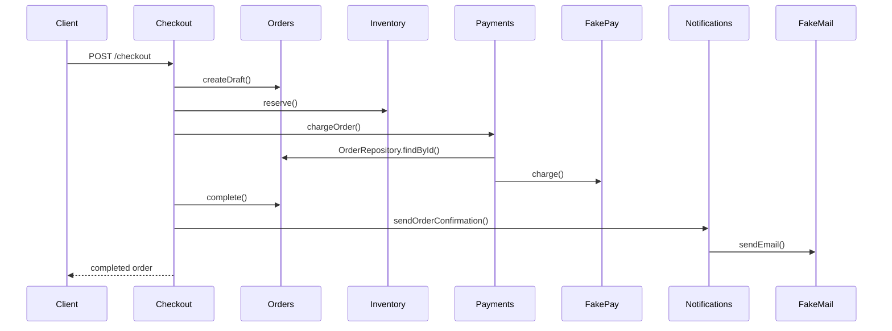
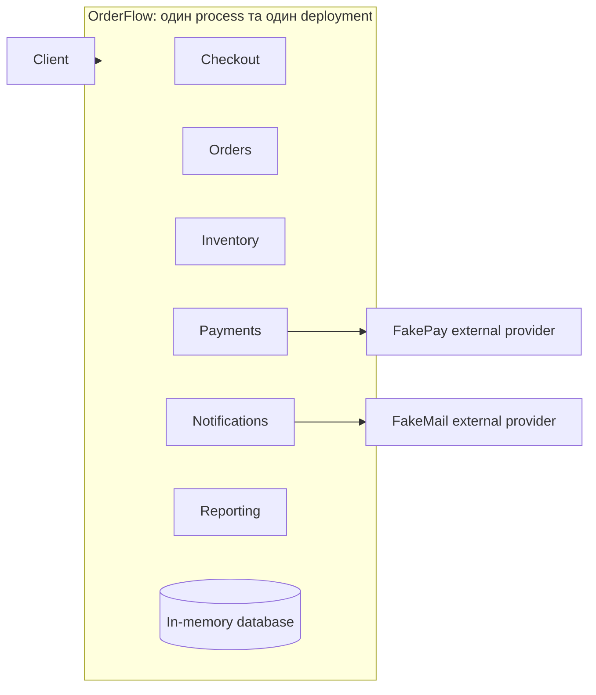

# Поточна система

OrderFlow приймає замовлення на техніку. Застосунок працює як modular monolith: усі модулі виконуються в одному process, користуються однією in-memory database та потрапляють в один deployment artifact.

## Модулі

| Модуль | Відповідальність |
| --- | --- |
| Orders | Створення замовлення та зміна його status |
| Inventory | Перевірка й резервування товарів |
| Payments | Виклик зовнішнього payment provider та запис платежу |
| Notifications | Формування і синхронне надсилання email |
| Reporting | Sales summary на основі operational data |
| Checkout | Координація повного checkout flow |

## Runtime flow

## Deployment

Зміна в одному модулі запускає тестування та deployment усього застосунку. Окремих queues, services або databases немає.

## HTTP endpoints

| Method | Path | Призначення |
| --- | --- | --- |
| GET | `/health` | Health check |
| GET | `/products` | Поточні залишки |
| POST | `/checkout` | Оформлення замовлення |
| GET | `/orders` | Список замовлень з optional status filter |
| GET | `/orders/:id` | Перегляд замовлення |
| GET | `/reports/sales` | Sales summary |
| GET | `/reports/operational-health` | Operational summary |

FakePay зазвичай відповідає за 100-300 ms, іноді за 1500-3000 ms і приблизно у 5% викликів повертає помилку. Значення можна змінити через environment variables у `src/config.js`.
